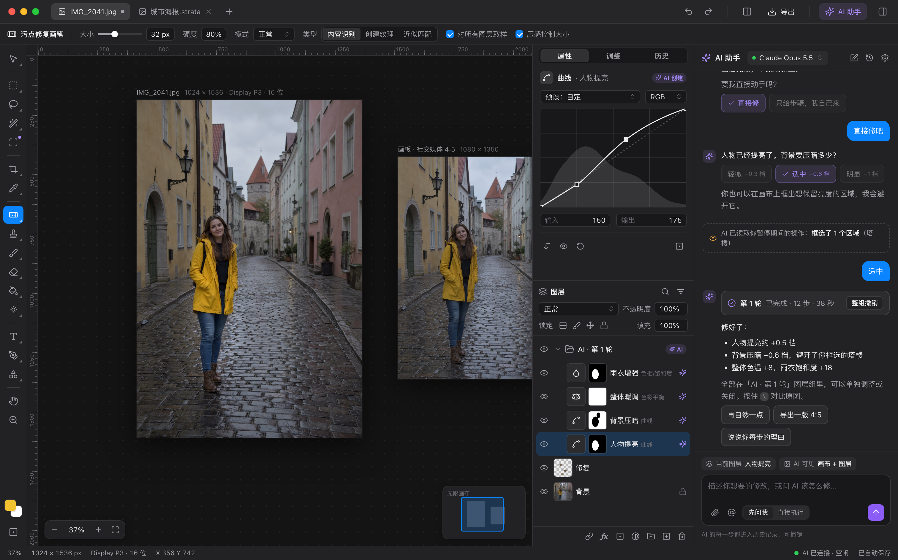

# Strata

Strata 是一个开源的、可以完全由 AI 驱动的专业级图像编辑器。第一版面向 macOS，核心使用可移植的 Rust。

Strata is an open-source, AI-operable image editor with a portable Rust core and a native macOS shell. It is under active development and is not ready for editing real projects.



## 当前状态

目前在 [BugCooker-cooking/strata](https://github.com/BugCooker-cooking/strata) 私有开发；成品完成后再决定公开，不自动切换仓库可见性。

M0 开发中。已有可运行的原生只读图像预览：打开常见图片、平移/缩放、8/16 位源像素保留、ICC → Display P3 显示、错误处理。上图是完整 v1 的界面设计稿，不是当前功能截图。尚无编辑、图层、保存或 AI；不要把它当作正式编辑器。

M0 的当前 Mac 基准已通过，额外设备与人工显示/输入验收继续追踪；M1a 已开始可移植基础工作，首步为 8/16 位稀疏分块与写时复制，尚未接入产品编辑流程。见 [M1a 实施记录](docs/research/2026-11-m1a-progress.md)。

## 开发

- Rust **1.97.1**（rustup 自动读取 `rust-toolchain.toml`）。
- macOS 本机验证环境：Apple Silicon、Xcode **27.1** / Swift **6.4**、XcodeGen **2.45.4**。
- 远程已通过：Ubuntu 24.04、macOS 15 arm64；原生环境 Xcode **16.4** / Swift **6.1.2**、XcodeGen **2.46.0**。
- 最终应用最低运行版本目标为 macOS **14.0**；该最低版本尚未实机验证。

```sh
make run
make test
make lint
make test-gpu
make color-fixtures
make benchmark
make verify-clean
```

`make run` 自动编译 Rust、生成 Swift 绑定与 Xcode 工程并启动应用。`make test` 同时跑 Rust 和 XCTest；Linux 使用 `make test-core`。`make test-gpu` 要求真实 GPU，不允许以无 adapter 跳过代替通过。Release 使用 `make run CONFIGURATION=Release FRAME_STATS=1`。

`make color-fixtures` 生成原生 P3 色块、完整 16 位灰阶和透明边缘，拒绝覆盖已有输出；再次生成时指定 `FIXTURE_OUTPUT=build/color-fixtures-v2`。`make benchmark` 运行真实 Release 画布，置顶诊断窗口完成 3×30 秒平移缩放，原始时间戳和环境写入独立的 `build/canvas-benchmark.*/report.json`；期间请勿操作该窗口，遮挡、尺寸/屏幕变化或用户输入会中止测量。报告记录置顶模式、60Hz 请求频率与屏幕实际刷新能力，不把 CPU 提交当作 GPU 呈现时间。

`make verify-clean` 要求工作区已提交，从精确 HEAD 导出无 `target`、绑定和 Xcode 工程的源码，在独立目录执行 `make test`，只复用已下载的依赖源码。它不删除当前构建，也不修改工作区。

M0 打开 PNG/JPEG/WebP/TIFF/GIF/BMP（GIF 首帧），HEIC 与不兼容的灰度/CMYK ICC 暂不支持。最终 RGBA 解码缓冲限 512 MiB，图像边长受 GPU 限制，M1 才分块。屏幕缓存可降精度，但不回写源图；没有保存功能。详细证据和未完成门槛见 [M0 进度](docs/research/2026-11-m0-progress.md)。

## 文档与贡献

[文档入口](docs/README.md) · [实施计划](docs/plans/2026-11-02-strata-v1-roadmap.md) · [贡献指南](CONTRIBUTING.md) · [行为准则](CODE_OF_CONDUCT.md)

许可证：[Apache-2.0](LICENSE)。依赖保留其原许可证；发布前生成第三方许可清单。远程保持私有，CI 状态以实际运行记录为准。
