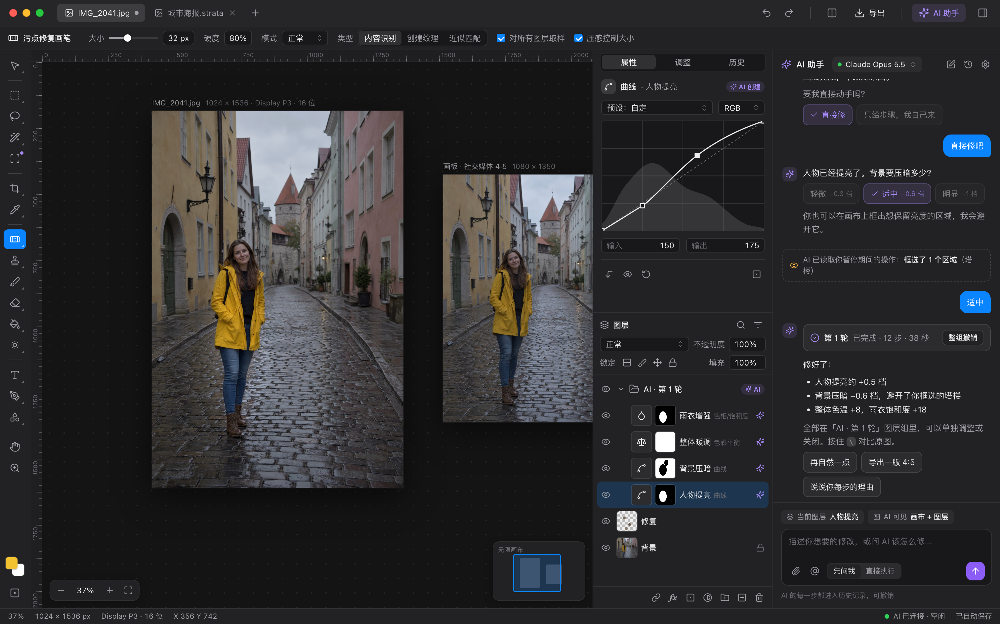

# Strata 文档

Strata 是一个开源的、可以完全由 AI 驱动的专业级图像编辑器。第一版是 macOS 原生应用。

当前已接入 M1a 图层编辑、命令/历史、工程保存和同位深导出；尚无模型接入、选区或蒙版。v0.1 仍以“主体选择 + 蒙版曝光 + 用户修正 + 安全保存”为目标，完整 P0 作为 v1.0 目标。已验证与未完成门槛见 [M1a 记录](research/2026-11-m1a-progress.md)。

原生界面框架、独立文档标签、最近文件与图片置入已落地；见 [工作区计划](plans/2026-11-03-workspace-and-m1b.md) 与 [实施记录](research/2026-11-workspace-progress.md)。下图仍是设计稿。



## 从这里开始

| 文档 | 内容 |
|---|---|
| [第一版总体设计](design/2026-11-02-strata-v1-design.md) | 定位、目标与反目标、写死的硬规则、技术架构、命令系统、操作权锁、AI 接口层 |
| [第一版界面关键点](design/ui-v1.md) | 窗口结构、各区域说明、四种界面状态、颜色语义、快捷键、Swift 实现要点 |
| [第一版实施计划](plans/2026-11-02-strata-v1-roadmap.md) | 整体走向、里程碑 M0–M8、每个里程碑的交付内容、完成标准与 AI 验收任务 |
| [P0 交付与验收矩阵](plans/2026-11-02-p0-acceptance-matrix.md) | 每条 P0 功能的交付里程碑、稳定验收 ID 与测试要求，防止遗漏和倒置依赖 |
| [M0 详细实施计划](plans/2026-11-02-m0-foundation.md) | 项目地基、桥接/渲染/色彩与 8/16 位验证、打开失败安全、干净构建与画布生命周期 |
| [M0 实施进度](research/2026-11-m0-progress.md) | 本机与双平台 CI 证据、接口偏差、仍待实机验证的门槛 |
| [M0 实机验收表](research/2026-11-m0-hardware-checklist.md) | P3 对色、触控板、跨屏、窗口恢复、标准机与最低系统的步骤和记录模板 |
| [M1a 详细计划](plans/2026-11-02-m1a-core-storage.md) / [实施记录](research/2026-11-m1a-progress.md) | 分块、图层、命令/历史、工程往返、当前 Mac 验收与 M1b 边界 |
| [工程格式与命令](research/2026-11-m1a-format-and-commands.md) | SQLite v0、安全写入、能力句柄、命令目录与可重现演示 |
| [M1b 尺寸/HEIC/恢复/内存验收](research/2026-11-m1b-recovery-memory-progress.md) | 导出重采样、系统 HEIC、空闲恢复、全局预算与 50MP×30 独立图层压力验证 |
| [M1b 导出选项验收](research/2026-11-export-options-progress.md) | JPEG/无损 WebP、输出 ICC、质量/背景、显式量化与原生验证 |
| [桥接](research/2026-11-m0-bridge-uniffi.md) / [渲染](research/2026-11-m0-rendering-wgpu-metal.md) / [色彩](research/2026-11-m0-color-p3.md) | 技术验证记录；不把未实测项目标成完成 |
| [Photoshop 功能全景与优先级](research/photoshop-feature-inventory.md) | Photoshop 全部功能的分类清单，以及 Strata 的优先级（P0–P3） |

## 设计资源

| 资源 | 说明 |
|---|---|
| [design/strata-ui-mockup.html](design/strata-ui-mockup.html) | 可点击的界面设计稿：键盘 1–4 切换状态，T 切换深浅色；地址加 `?clean=1` 隐藏原型控制条（图标从 CDN 加载，需要联网） |
| [design/screenshots/](design/screenshots/) | 界面截图：手动编辑、AI 执行中、AI 等你决定、未接入模型、浅色主题 |
| [design/assets/sample-photo.jpg](design/assets/sample-photo.jpg) | 设计稿中使用的示例照片（AI 生成） |

## 目录约定

```
docs/
├── design/      设计文档、界面设计稿与截图
├── plans/       实施计划（总计划 + 每个里程碑开工前的详细计划）
├── research/    调研与技术验证结论
└── commands/    命令参考（以后由命令注册表自动生成）
```
