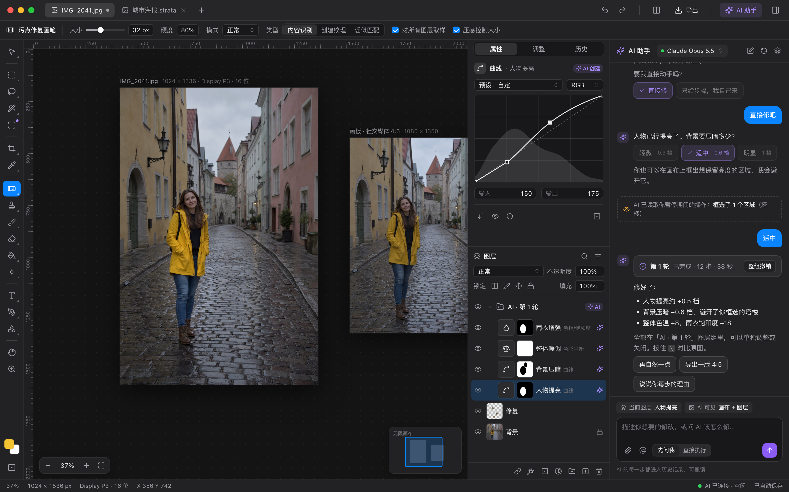

# Strata 第一版总体设计

| 项目 | 内容 |
|---|---|
| 状态 | 计划审查修订版；保留已确认的产品与界面方向，颜色后期再调 |
| 日期 | 2026-11-02 |
| 相关文档 | [界面关键点](ui-v1.md) · [第一版实施计划](../plans/2026-11-02-strata-v1-roadmap.md) · [Photoshop 功能全景与优先级](../research/photoshop-feature-inventory.md) · [界面设计稿](strata-ui-mockup.html) |

本文是 Strata 第一版的总体设计：为什么做、做成什么样、怎么搭架构、哪些规则写死。实现者读完本文和相关文档，应该能直接开始拆任务，不需要再回头问。

**2026-11-02 修订范围**：保留 v1.0 的 P0 功能范围与技术栈；将 v0.1 改为真实局部修图闭环，补齐位深、命令副作用、授权、保存恢复与内存预算的约定。下述验收指标是待实现的门槛，不代表已有实测结果。执行顺序以修订后的路线图为准。

文中标注 **【用户决定】** 的是项目发起人明确拍板的；标注 **【Claude 的判断】** 的是讨论中交给 Claude 定的，发起人可以推翻；标注 **【留给实现者】** 的是实现时可自行决定的细节。

---

## 1. 一句话定位

**Strata 是一个开源的、可以完全由 AI 驱动的专业级图像编辑器。** 它具备 Photoshop 级别的修图与图层能力，人可以完整地手工操作；用户接入自己的大模型后，AI 能直接看到画布和图层、找到并调用软件里的任何功能，配合用户完成修图。第一版是 macOS 原生应用。

## 2. 为什么做

### 2.1 现在的问题

今天让 AI 帮忙修图，AI 只能站在软件外面：写 Python 脚本、拼命令行、或者模拟鼠标点击。它看不到软件内部的图层状态，也不知道软件有哪些功能、每个功能怎么调用。

### 2.2 Strata 的做法【用户决定】

- AI 待在软件里面，可以访问软件的一切方法（这些方法对内置 AI 完全开放）。
- 所有方法按层级分类。AI 想做某件事时，一层一层找到需要的功能，读取它的说明，然后直接调用，不写代码、不走命令行。
- 不会把全部方法一次性塞进模型的上下文，而是按需逐层读取。
- 用户界面右侧有聊天面板，用户可以问"这张图应该怎么修"，也可以让 AI 直接动手。

### 2.3 和已有产品的区别

Adobe 在 2026 年给 Photoshop 加了 AI Assistant（3 月网页/移动端公测，6 月桌面端早期测试），用自然语言描述修改、分步执行。但根据公开报道，它并不保证能调用所有功能，且绑定 Adobe 自己的模型和生成额度。Strata 的差异：

| | Strata | Photoshop AI Assistant |
|---|---|---|
| 源代码 | 开源 | 闭源 |
| 模型 | 用户自带（云端或本地） | Adobe 指定 |
| 功能覆盖 | 架构保证：手工能做的 AI 都能做 | 部分功能 |
| 数据 | 可完全本地运行 | 依赖 Adobe 云 |

---

## 3. 目标、非目标与反目标

### 3.1 第一版目标

1. **产品级的手工编辑器**：[功能清单](../research/photoshop-feature-inventory.md)中所有 P0 功能都能手工使用，质量达到日常可用。【用户决定：基础修图全部跑通、图层功能全部跑通、常用工具（选区等）、无限画布】
2. **P0 功能全部可被 AI 调用**，且只通过统一的 AI 入口。
3. **用户自带模型**：支持 Anthropic、OpenAI 兼容接口（含各类中转和国产模型）、本地模型（Ollama / LM Studio）。【Claude 的判断，界面稿已展示，用户已认可】
4. **AI 能看、能建议、能动手**：AI 可读取画布图像和图层数据，给出修图建议，或直接执行。
5. **无限画布**：文档与画板放在一张无边界的画布上。【用户决定要无限画布；具体形态按界面稿，用户已认可】
6. **为后续预留**：核心代码可移植（为 Windows 版），AI 接口层独立（为 MCP）。【用户决定：MCP 第一期不做，但必须预留口子】

### 3.2 第一版不做（非目标）

- Windows 版（架构预留，不实现）
- MCP Server（接口预留，第二批实现）
- 功能清单中 P1 及以后的功能：智能对象、钢笔与矢量、PSD 读写、液化、内容识别填充等；仅保留既有界面/路线图明确纳入的多画板、小地图、文档 ICC 指定/转换三项扩展，不把其他 P1 顺带纳入
- 生成式 AI 功能：生成式填充、生成式扩展、超分辨率等
- 插件系统、云同步、多人协作
- 视频、3D

### 3.3 反目标（就算功能跑通，出现这些也算失败）

- 存在"界面能做、AI 做不了"的功能。
- AI 通过写脚本、命令行或模拟点击来操作软件。
- 把全部功能说明一次性塞进模型上下文。
- AI 执行时用户也能同时修改文档，导致状态混乱。
- AI 的修改不能撤销，或在用户不知情时破坏性地改动原图。
- 强制联网、强制使用某一家模型、或收集用户图片。
- 使用 Adobe 的商标、图标或界面素材。功能名称使用行业通用叫法即可。

---

## 4. 写死的硬规则

以下规则是 Strata 的地基，任何代码都不能绕过。代码评审和 CI 负责把关。

| 编号 | 规则 | 怎么保证 |
|---|---|---|
| R1 | **一切皆命令**：所有修改文档的操作都必须是注册过的命令。界面不能直接改文档，只能派发命令 | 文档模型的可变接口只对命令执行器开放（Rust 可见性控制） |
| R2 | **每个命令自带说明书**：用途、参数格式、返回值、前置条件、示例 | 说明书从代码类型自动生成；CI 检查每个命令说明完整，且示例能在无界面环境下执行成功 |
| R3 | **人和 AI 能力一致**：新增功能就是新增命令，注册后自动对 AI 可见；能力一致不代表免除授权 | 不存在"仅界面"的修改路径（见 R1）；同一入口按来源检查权限 |
| R4 | **AI 只通过 AI 接口层访问功能**，按层级发现，不一次性加载全部说明 | AI 只拿到固定的几个元工具（见 §7.2） |
| R5 | **AI 接口层独立于任何前端**：聊天面板只是第一个使用者，MCP 是第二个 | AI 接口层位于 Rust 核心，不依赖 Swift 或界面代码 |
| R6 | **操作权锁做在核心层**，不只是界面上把按钮变灰 | 命令总线在执行前检查锁状态与命令来源 |
| R7 | **所有已提交的文档编辑进入同一条可撤销历史**；AI 的一轮文档编辑可整组撤销。打开/关闭等生命周期操作与文件写入单独留执行记录，不承诺由撤销恢复 | 命令执行器按副作用类别写历史或执行记录；界面明确撤销边界 |
| R8 | **核心代码不依赖平台 API**：平台相关代码只在外壳里 | 核心 crate 禁止依赖 AppKit/Win32 等；CI 在 Linux 上编译核心 |

---

## 5. 技术架构

### 5.1 总览

Strata 走和 Photoshop 一样的路线：**一套可移植的核心，加上各平台的一层薄壳**。Photoshop 从 1993 年起就用同一套 C++ 核心代码支持 Mac 和 Windows，后来的 iPad 版和网页版（WebAssembly）也复用这套核心。

```
┌──────────────────────── macOS 外壳（Swift） ────────────────────────┐
│  画布视图（AppKit + CAMetalLayer）  面板（SwiftUI）  AI 聊天面板     │
│  窗口 / 菜单 / 快捷键 / 钥匙串 / 文件对话框 / 系统集成               │
└──────────────────────────────┬──────────────────────────────────────┘
                               │ UniFFI 绑定：命令派发 + 状态查询 + 事件回调
┌──────────────────────────────┴───── Strata Core（Rust） ─────────────┐
│  命令总线 ── 命令注册表 ── 说明书生成          操作权锁   历史记录    │
│  文档模型：画布 / 画板 / 图层树 / 蒙版 / 选区 / 通道                  │
│  渲染引擎：wgpu、分块、无限画布、混合模式与调整着色器                 │
│  图像算子：调整、滤镜、修复、绘画（CPU / GPU）                        │
│  AI 接口层：功能目录、元工具、Agent 循环、模型提供方适配              │
│  模型插槽：ONNX Runtime（选择主体等）                                 │
│  文件：编解码、.strata 工程格式        色彩管理：ICC                  │
└──────────────────────────────────────────────────────────────────────┘
          ▲ 以后：Windows 外壳（同一套核心）        ▲ 以后：MCP Server（同一套 AI 接口层）
```

### 5.2 技术选型【Claude 的判断，用户已授权】

| 层 | 选择 | 理由 |
|---|---|---|
| 核心语言 | Rust | 可移植；内存安全，适合长期开源维护；对贡献者友好 |
| GPU | wgpu | 一套代码在 Mac 走 Metal、在 Windows 走 DX12/Vulkan |
| Mac 界面 | Swift：画布用 AppKit + CAMetalLayer，面板用 SwiftUI | 原生体验；画布需要 AppKit 级别的输入和性能控制 |
| 桥接 | UniFFI（Mozilla） | 从 Rust 自动生成 Swift 绑定，以后也能生成 C#/Kotlin |
| 参数格式 | serde + schemars | Rust 类型直接生成 JSON Schema，说明书与代码不会脱节 |
| 异步与网络 | tokio + reqwest | Agent 循环与模型 API 调用 |
| 色彩管理 | Little CMS 2 | 业界标准，MIT 许可 |
| 机器学习推理 | ONNX Runtime（`ort` crate） | 跨平台；Mac 上可启用 Core ML 加速 |
| 未选方案 | Electron/Tauri（非原生、大画布性能不足）；全 Swift（Windows 要重写）；Qt（非 Mac 原生观感、许可证复杂）；C++ 核心（开源贡献门槛高） | |

图像编解码、文字排版等具体库【留给实现者】，约束是：许可证与项目许可证兼容，能在核心里跨平台运行。HEIC 解码在 Mac 上可由外壳调用系统 ImageIO 提供，Windows 版再补。

### 5.3 代码仓库结构【Claude 的判断，实现者可调整】

```
strata/
├── crates/
│   ├── strata-core/      文档模型、命令总线、注册表、历史、操作权锁
│   ├── strata-pixels/    无平台依赖的像素格式、位深与缓冲校验
│   ├── strata-ops/       像素算子：调整、滤镜、修复、绘画
│   ├── strata-render/    wgpu 渲染：分块合成、混合模式、视图变换
│   ├── strata-io/        图片编解码、.strata 工程格式
│   ├── strata-color/     色彩管理
│   ├── strata-ai/        AI 接口层：功能目录、元工具、Agent 循环、模型适配
│   ├── strata-ml/        模型插槽：ONNX 推理、模型下载与校验
│   ├── strata-ffi/       UniFFI 绑定（供 Swift 调用）
│   └── strata-devtool/   开发与测试工具：无界面执行命令、跑示例、导出说明书
├── apps/
│   └── macos/            Xcode 工程（Swift）
├── docs/                 设计、计划、调研、自动生成的命令参考
└── .github/              CI、Issue/PR 模板
```

`strata-devtool` 是给开发者和 CI 用的（跑测试、校验说明书、做 AI 评测），**不是给 AI 用的入口**。AI 只走 AI 接口层（反目标第 2 条）。

---

## 6. 核心子系统

### 6.1 文档模型

```
Document
├── canvas            无限画布：所有内容所在的无边界坐标空间
├── frames[]          画板：定义导出范围（打开一张图片时自动创建一个与图片同尺寸的画板）
├── layers            图层树
├── selection         当前选区（像素级遮罩 + 边界）
├── channels[]        Alpha 通道（存储的选区）
├── color             色彩模式、位深（8/16）、工作色彩空间与 ICC
└── active_layer      当前图层
```

**第一版图层类型**：像素图层、图层组（可嵌套）、调整图层（17 种）、填充图层（纯色、渐变）、文字图层。

**每个图层的公共属性**：

| 属性 | 说明 |
|---|---|
| `id` | 稳定的唯一 ID，跨撤销、保存保持不变。**AI 引用图层靠它**，不用下标 |
| `name` | 名称；AI 也可以按名称引用，重名时返回候选列表 |
| `visible` / `locks` | 显隐；锁定（透明像素、像素、位置、全部） |
| `opacity` / `fill_opacity` | 不透明度 / 填充不透明度 |
| `blend_mode` | 27 种混合模式 |
| `mask` | 可选的像素蒙版（可停用、可反相） |
| `clipped` | 是否作为剪贴蒙版剪贴到下方图层 |
| `styles` | 第一版 5 种：投影、描边、外发光、颜色叠加、渐变叠加 |
| `origin` | `user` / `ai`（界面上的 AI 标记依据它；仅用于展示，不影响行为） |

### 6.2 无限画布与分块存储

- 图层像素按 **256×256 分块**稀疏存储，没有内容的区域不占内存。图层内容不被画板边界裁切。
- **画板**决定导出范围。"画布大小"改的是画板；"裁剪"改的是画板，并可选择是否删除画板外的像素（与 Photoshop "删除裁剪的像素"选项一致）。
- 每个分块维护多级缩略（mipmap），缩小查看时只读取低分辨率级别。
- 位深：解码、文档存储、色彩转换、历史与工程保存从 M0/M1 起显式区分 `Rgba8` 与 `Rgba16`，不得把 16 位输入先降到 8 位。共享类型放在 `strata-pixels`，不依赖渲染器或外壳。
- GPU 显示/合成可采用半精度浮点缓存，但缓存不是文档真值；半精度浮点不能自动等同于保留 16 位整数精度。无编辑的保存重开必须保留原像素；16 位编辑/导出路径须有高精度参考与误差界限，未通过时改用更高精度路径，禁止拿 8 位屏幕回读当导出结果。
- 分块边长初始为 256，可依据实测调整；内存必须有全局预算、CPU/GPU 缓存淘汰、历史配额和磁盘后备存储。写时复制与稀疏分块不能代替预算控制。M1 先验证超内存工作集，具体基准见 §6.10。

### 6.3 渲染

- 画布视图是 Swift 侧的 AppKit 视图，持有一个 `CAMetalLayer`；Rust 核心通过 wgpu 从这个 layer 创建绘制表面，直接渲染。Swift 不处理像素。
- 合成按分块进行：从下往上按图层树合成，混合模式和调整图层都实现为着色器。
- 缓存：图层没变的分块不重算；调整参数变化时只重算受影响的分块。
- 画布上的叠加层（选区蚂蚁线、变换框、参考线、AI 选区高亮、用户框选的区域）由核心统一渲染。

### 6.4 命令系统

#### 命令的组成

每个命令包含：

| 字段 | 说明 |
|---|---|
| `id` | 全局唯一，如 `adjust.curves.set` |
| `path` | 在功能目录中的位置，如 `["adjust", "curves"]` |
| `title` | 界面显示名（中 / 英） |
| `summary` | 一句话用途（给 AI 浏览目录时看） |
| `description` | 详细说明（给 AI 读说明书时看）：做什么、什么时候用、注意事项 |
| `kind` | `query`（只读文档）、`mutate`（可撤销文档修改）、`view`（临时视图）、`external`（文件/剪贴板等外部副作用）、`lifecycle`（文档新建/打开/关闭）、`history`（撤销/重做） |
| `effects` / `permissions` | 明确声明读写哪些资源、是否向模型发送数据、需要哪些授权；复合操作声明全部副作用 |
| `batchable` | 是否可加入文档原子事务；第一版仅允许同一文档内、不含外部副作用的 `query` / `mutate` |
| `params` | 参数的 JSON Schema（由 Rust 类型自动生成） |
| `returns` | 返回值的 JSON Schema |
| `preconditions` | 前置条件，如"目标必须是曲线调整图层" |
| `examples` | 至少 1 个示例（参数 + 说明）；CI 会实际执行 |
| `undoable` | `mutate` 一律为是；`history` 仅移动历史游标，不能把撤销自身再追加为普通修改 |

#### 命名约定【Claude 的判断】

- 格式：`<领域>.<对象>.<动作>` 或 `<领域>.<动作>`，全小写，多个单词用下划线。
- 领域与[功能清单](../research/photoshop-feature-inventory.md)的分类一一对应：`file` `edit` `image` `layer` `select` `adjust` `retouch` `paint` `transform` `filter` `type` `view` `color` `channel` `document`。
- 动作词优先使用 `create` `delete` `duplicate` `set` `get` `list` `add` `remove` `apply` `move` `merge` `convert`；已有的 `open`、`save`、`export`、`inspect`、`subject` 等语义名称同样有效，由注册表校验唯一性，不用与示例冲突的封闭词表限制。
- 示例：`layer.create`、`layer.set_blend_mode`、`select.subject`、`select.modify.feather`、`adjust.curves.set`、`filter.gaussian_blur.apply`、`document.inspect`。

#### Rust 写法示意（实现者可调整）

```rust
/// Set the tone curve points of a Curves adjustment layer.
/// Use it to change brightness/contrast in specific tonal ranges.
#[derive(Deserialize, JsonSchema)]
pub struct SetCurves {
    /// Target Curves adjustment layer (id or unique name).
    pub layer: LayerRef,
    /// Channel to edit.
    #[serde(default)]
    pub channel: CurveChannel, // rgb | red | green | blue
    /// Normalized [input, output] in 0–1, finite, at least 2, sorted by input.
    pub points: Vec<[f32; 2]>,
}

#[command(id = "adjust.curves.set", kind = Mutate, title_zh = "设置曲线", title_en = "Set Curves",
          example = r#"{"layer":"人物提亮","points":[[0,0],[0.25,0.23],[0.59,0.69],[1,1]]}"#)]
fn set_curves(ctx: &mut CommandCtx, p: SetCurves) -> Result<LayerInfo> { /* … */ }
```

宏负责：把结构体文档注释变成说明、生成 JSON Schema、注册到目录、生成界面标题、把示例加入 CI 测试。

**说明书的语言**【Claude 的判断】：简介和说明用英文撰写（主流模型对英文技术说明理解最稳定），用户仍然可以用中文和 AI 对话；界面标题提供中英文两份，`search_catalog` 同时匹配中英文标题和简介。

#### 执行流程

```
dispatch(来源, 命令 id, 参数)
  → 操作权锁与资源授权检查（来源、回合、文档、文件句柄、外发范围）
  → 参数校验（JSON Schema + 业务校验）
  → 前置条件检查
  → 检查文档 revision；准备候选结果，执行前不改当前状态
  → 按副作用类别提交（文档事务失败则回滚；外部操作采用独立提交协议）
  → 写入文档历史或外部执行记录（标注来源与 AI 回合）
  → 发出事件（图层变化、选区变化、需要重绘的分块……）
  → 返回结果
```

**命令来源**：`User`（界面）、`Ai { turn_id }`（AI 回合）、`Test`（测试与开发工具）、以后的 `Mcp { client }`。

**事务与外部操作边界**：

- `invoke_batch` 在执行任何一步前校验整批：只允许同一文档内的 `batchable` 命令。保存、导出、打开/关闭文档、系统剪贴板写入、撤销/重做一律拒绝混入，返回可解释错误；不能执行了一半才发现无法回滚。
- 批量创建后引用新图层，通过批内结果引用（如 `steps[0].result.layer_id`）解析稳定 ID，禁止猜测 ID。结果引用只在该事务内有效。
- `file.save` / `file.export` 是外部写入，记录目标与完成状态，不进入文档撤销栈；`file.place` 是带受授权文件读取的文档修改，第一版不加入 batch。剪切/粘贴等复合操作声明文档与剪贴板两类效果，撤销只恢复文档、不恢复系统剪贴板。
- `file.new/open/close` 属于生命周期操作：读取与验证完成后再改变活动文档；替换/关闭脏文档必须确认。打开失败保留旧文档、旧画面和历史，不发送成功事件。
- 每次调用带由宿主绑定的 `document_id`、`turn_id` 与 `call_id`；模型不能自报来源或扩大权限。单次调用重试复用 `call_id`，避免重复创建/写入。长任务准备阶段读取 revision，提交时再次检查；停止或回合失效后迟到结果不得提交。

#### 交互式工具也是命令

画笔、拖动变换这类连续交互不是一次性点击，处理方式是**交互会话，最后提交为一条命令**：

- 用户按下鼠标开始会话，拖动过程中核心实时预览（不写历史），松开时提交为一条命令，例如 `paint.stroke { layer, brush, points: [...] }` 或 `transform.apply { layers, matrix }`。
- AI 调用同一个命令，直接给出笔画点序列或变换矩阵。
- 这样画笔、变换也满足 R1、R3：人和 AI 走同一个命令，历史里也是一条记录。

#### 只读查询也注册为命令

`document.inspect`、`layer.list`、`image.histogram`、`color.sample` 这类查询同样注册，`kind = query`，不进历史，锁不阻止查看已授权文档；读取其他文件、系统剪贴板或发送图片不因此自动获得授权。

### 6.5 历史与撤销

- 每个文档一条线性历史，该文档的所有来源共用。每条记录包含：命令、来源（用户 / AI）、所属 AI 回合、时间、可读描述；外部执行记录单独展示。
- 撤销粒度：单步撤销；AI 回合可整组撤销（撤销该回合已提交的文档编辑，包括暂停期间用户编辑，不撤销外部副作用或生命周期操作）。
- 实现建议：分块写时复制（只保存被改动分块的旧版本），避免整图快照【留给实现者】。
- 第一版完整撤销历史不随工程文件保存；恢复检查点/恢复日志是独立的数据安全机制，不以持久化完整撤销历史为前提。
- 整组撤销只支持当前历史尾部的该回合；若后面已有用户修改，明确提示需要先撤销这些后续步骤，不做隐式选择性撤销。暂停期间的撤销/重做动作另记事件序列，不能仅从当前历史分支推断。

### 6.6 操作权锁【用户决定】

```
                 用户发起 AI 请求
   ┌──────────┐ ─────────────────▶ ┌──────────┐
   │ 用户掌控 │                    │ AI 执行中 │ ◀──┐
   └──────────┘ ◀───────────────── └──────────┘    │ 用户回答 / 选择选项
        ▲   ▲     AI 完成本轮           │           │
        │   │                          │ AI 调用 ask_user
        │   │     用户点停止            ▼           │
        │   └──────────────────── ┌──────────┐ ────┘
        └──────────────────────── │ AI 暂停   │
              用户点停止 / 结束本轮 └──────────┘
```

| 状态 | 用户能做 | AI 能做 | 界面表现 |
|---|---|---|---|
| 用户掌控 | 全部（外部写入仍检查目标） | 没有进行中的回合，不得修改文档、移动历史或执行外部/生命周期操作 | 正常 |
| AI 执行中 | 只能查看：缩放、平移、查看历史；聊天面板可输入补充要求；可以停止 | 已授权命令；批量与外部副作用仍受上述限制 | 除聊天面板外全部只读；画布紫色边框；顶部提示条显示当前步骤和停止按钮 |
| AI 暂停 | 少量操作：查看、开关图层显隐对比、选框/套索指点、撤销 AI 的步骤；回复 AI | 等待用户，不得修改文档、移动历史或执行外部/生命周期操作 | 琥珀色提示条；允许的工具可用，其他只读 |

规则细节：

- 锁在命令总线里检查，界面置灰只是表现（R6）。被拒绝的命令返回 `ControlLocked` 错误。
- **用户停止时**：先撤销回合的提交资格；未提交的文档命令在安全点中止并丢弃候选结果，已完成步骤保留。外部写入在原子提交前取消并清理临时结果，提交后只能如实报告已完成，不能声称已回滚。底层任务若不能立即停止计算，也不得再改变文档。
- **AI 恢复执行时**，收到当前文档 revision、最新状态和暂停期间事件序列（包含撤销/重做），重新验证引用后继续。显隐和选区是可撤销修改，暂停时通过明确的命令白名单放行，不伪装为只读查询。
- 锁的范围是**整个应用**，包括其他打开的文档。
- `kind = view` 的缩放、平移、临时对比只改变视图、不进历史，任何状态下用户都可执行。持久化参考线等即使位于 `view.*` 命名空间也属于 `mutate`，不能按名称前缀放行。AI 可定位到处理区域，但用户动过视图后不再自动移动，以免抢视图。
- 以后的 MCP 外部 AI 与内置 AI 遵守同一套规则：外部 AI 也要先开启一个回合才能修改。

### 6.7 AI 接口层：见 §7（本设计的核心）

### 6.8 模型插槽（本地 AI 模型）

- 第一版只有一个用到模型的功能：**选择主体**（`select.subject`）。它是 P0，因为 AI 画不准套索，没有语义选区就做不了"人物提亮、背景压暗"这类局部修图。
- 用 ONNX Runtime 在本机推理，Mac 上启用 Core ML 加速。
- 默认模型首次使用时下载并校验哈希，保存在应用支持目录；用户可以替换。默认模型必须采用宽松许可证（如 MIT / Apache-2.0），**不能选用非商用许可的模型**。具体选哪个模型【留给实现者】，以效果、速度、许可证为准。
- 模型插槽设计成通用接口，第二批以后的移除背景、移除工具、生成式填充等都接在这里，并允许接云端模型。

### 6.9 文件格式与色彩

**.strata 工程文件**【Claude 的判断：推荐单文件 SQLite 容器，实现者可改用 zip 包，但需满足以下要求】：

- 带版本号，旧版本文件能被新版本打开
- 支持增量保存（自动保存只写改动的分块）
- 能快速读取缩略图和元数据，不用加载全部像素
- 保存完整的图层、蒙版、调整参数、画板、色彩信息
- M1 即实现失败安全：初次保存/另存为/导出用同目录临时文件、完整校验与持久化后原子替换；SQLite 增量保存用事务与明确的持久化设置，不能先截断旧文件。WAL/边车文件若存在，关闭、移动与备份必须保证工程自包含。
- M1 提供独立恢复副本与简单恢复入口；每次已提交修改后调度检查点，目标是在空闲时 30 秒内完成，并显示最近成功检查点时间。恢复到最近成功检查点，不承诺保存尚未提交的交互。
- 公开 v0.1 前必须测试保存中强制退出、磁盘满、权限拒绝、损坏/未知版本文件；每次保存中断后旧版或新版至少有一份完整可读。恢复副本不能覆盖唯一原件；失败不得清除脏标记或显示“已保存”。

**导入导出**：打开 PNG / JPEG / WebP / TIFF / HEIC / GIF / BMP；导出 PNG / JPEG / WebP / TIFF，可设置尺寸和质量，导出时嵌入或转换色彩配置文件。

**色彩管理**：工作色彩空间支持 sRGB 与 Display P3（Mac 屏幕是 P3 广色域）；读取并应用图片内嵌的 ICC；画布显示经过色彩管理。

### 6.10 性能目标【Claude 的判断，作为验收参考】

以 M1 芯片 MacBook Air、16 GB 内存为基准：

| 场景 | 目标 |
|---|---|
| 打开 2400 万像素 JPEG | 1.5 秒内可交互 |
| 2400 万像素、20 个独立满尺寸图层下平移缩放（8/16 位分别测） | 60 帧/秒，记录帧时间 p50/p95 与卡顿 |
| 画笔延迟 | 16 毫秒内 |
| 拖动调整参数时预览（适合屏幕缩放） | 不低于 30 帧/秒 |
| 5000 万像素、30 个独立满尺寸 16 位 RGBA 图层，含编辑与撤销 | 应用内存峰值 4 GB 以内；允许磁盘后备存储，另报磁盘占用和冷/热延迟 |

**预算与基准约定**：上述大图原始像素约 12 GB，不能靠共享同一图层、空图层或全零压缩冒充达标。M1 先生成逐块、固定随机种子的独立数据集（生成器自身不能一次分配 12 GB），实现超预算淘汰/回载与历史磁盘后备；M3 加入真实混合/调整后复测。目标 4 GB 分配为 CPU 文档/历史缓存约 1.5 GB、GPU 纹理缓存约 1 GB、其余运行时与临时缓冲预留约 1.5 GB；这是初始预算，须按峰值实测收紧，不能简单相加后宣称达标。

用 Release 构建，固定画布物理尺寸、缩放、图层内容、历史步数和交互脚本；分别记录打开峰值、冷/热平移、连续编辑/撤销、进程 physical footprint、GPU 分配量与磁盘 I/O。统一内存设备上避免把 CPU/GPU 共享内存重复计数。M0 的单图 60 帧只验证显示接线，不算多层引擎达标。预算耗尽或磁盘不足应返回可恢复错误，不崩溃、不丢旧文档；M1 完成时必须记录数据，未达标的目标明确标为阻塞项，不推迟到 M8 才测。

---

## 7. AI 接口层（核心设计）

### 7.1 功能目录

所有命令组成一棵树，结构和[功能清单](../research/photoshop-feature-inventory.md)的分类一致：

```
目录
├── document   文档信息与检查
├── file       新建、打开、保存、导出、置入
├── edit       撤销、拷贝粘贴、填充、描边
├── image      图像大小、画布大小、旋转、自动调色、模式与位深
├── layer      图层增删改、组、混合、蒙版、剪贴、样式、排列合并
├── select     选框、套索、魔棒、快速选择、选择主体、选区运算与修改
├── adjust     17 种调整（作为调整图层）
├── retouch    污点修复、修复画笔、仿制图章、减淡加深海绵
├── paint      画笔、橡皮擦、油漆桶、渐变、取色
├── transform  移动、自由变换、裁剪
├── filter     高斯模糊、USM 锐化、添加杂色
├── type       文字图层
├── view       缩放、平移、参考线（持久化参考线属于文档修改）
└── color      色彩空间与配置文件
```

每个节点都有一句话简介。AI 浏览某个节点时，只看到它的直接子节点（名称 + 简介 + 子项数量）。

### 7.2 元工具：模型实际拿到的工具

模型的工具列表是**固定的 8 个元工具**，不随功能数量增长：

| 元工具 | 作用 | 返回 |
|---|---|---|
| `browse_catalog(path?)` | 浏览目录的某一层 | 子节点列表：名称、简介、子项数 |
| `search_catalog(query, limit?)` | 按关键词搜索命令（中英文都可以） | 匹配命令的 id 与简介 |
| `describe_commands(ids[])` | 读取命令的完整说明书 | 说明、参数 Schema、返回值、前置条件、示例 |
| `invoke_command(id, params)` | 执行一个命令 | 结果 + 状态变化摘要 |
| `invoke_batch(steps[])` | 同一文档内的可批量 query/mutate 原子执行；执行前拒绝外部/生命周期/历史操作；任一步失败则文档整体回滚 | 每一步的结果，支持批内结果引用 |
| `inspect_document()` | 读取已授权文档结构化状态 | document_id/revision、图层树、当前图层、选区、尺寸与色彩、最近历史及暂停事件 |
| `view_canvas(region?, layers?, max_size?)` | 获取渲染图像：整体合成、指定图层或局部放大 | 图片；模型不支持看图时返回直方图、主色等文字统计 |
| `ask_user(question, options[]?)` | 向用户提问并暂停（进入"AI 暂停"状态） | 用户的回答 + 暂停期间用户的操作列表 |

说明：

- 主流模型 API 的工具名只允许字母、数字、下划线和连字符，所以元工具名用下划线；命令 id（如 `adjust.curves.set`）作为参数传入，不受此限制。
- 模型不再调用工具、给出最终回复时，本轮结束，回到"用户掌控"。

### 7.3 一次完整的调用过程

下面展示完整 v1.0 能力；v0.1 闭环使用曝光调整，不依赖 M5 才交付的曲线编辑器。对话开始前已完成当前文档的模型外发授权。

```
用户：这张图应该怎么修？
AI → inspect_document()                     读取图层树：背景、修复
AI → view_canvas(max_size=1024)             看到整体偏暗、偏冷，主体不突出
AI   给出建议，问"要我直接动手吗？"（"先问我"模式下必须先征得同意）
用户：直接修吧
AI → browse_catalog("select")               看到：选框、套索、魔棒、主体……
AI → describe_commands(["select.subject"])  读取参数说明
AI → invoke_command("select.subject", {})
AI → invoke_command("layer.add_adjustment", {"type":"curves","name":"人物提亮","mask":"from_selection"})
AI → invoke_command("adjust.curves.set", {"layer":"人物提亮","points":[[0,0],[0.25,0.23],[0.59,0.69],[1,1]]})
AI → ask_user("背景要压暗多少？", ["轻微 −0.3 档","适中 −0.6 档","明显 −1 档"])
     ……用户在画布上框选了塔楼，然后选择"适中"……
AI ← 回答"适中" + 用户操作：[select.marquee 区域 (476,224)-(624,730)]
AI → ……压暗背景并避开框选区域、整体暖调、增强雨衣饱和度……
AI   总结本轮修改
```

### 7.4 返回内容的设计

- **结果要简短**：成功时返回关键信息与状态变化摘要（如"新建图层 人物提亮（id: L7），已添加蒙版"），不返回大段数据。
- **错误要能指导下一步**：例如"当前没有选区，可以先调用 `select.subject`"或"参数 points 至少需要 2 个点，当前只有 1 个"。
- **图层引用**：既接受 id 也接受名称；名称重复时报错并列出候选。

### 7.5 模型提供方适配

| 提供方 | 接口 | 说明 |
|---|---|---|
| Anthropic | Messages API 的工具调用 | 支持看图 |
| OpenAI 兼容 | Chat Completions 的函数调用 | 覆盖 OpenAI、DeepSeek、通义千问及各类中转；可自定义接口地址 |
| 本地 | Ollama / LM Studio 的 OpenAI 兼容接口 | 数据不出本机 |

- 内部统一成一种工具调用表示，Agent 循环不关心具体提供方。
- 连接时检测模型能力：是否支持工具调用（必需）、是否支持看图（可选，不支持时 `view_canvas` 返回文字统计）。
- 不支持看图的模型可执行明确命令，但不得把统计信息当成“看到了人物/物体”；v0.1 的自主修图验收使用支持看图的模型，非视觉模型单独验证降级行为。
- 流式输出，界面实时显示 AI 的文字与步骤。

### 7.6 Agent 循环

- 位于 Rust 核心（`strata-ai`），Swift 只负责显示。以后的 Windows 版和 MCP 都直接复用。
- 系统提示词包括：Strata 简介、操作权规则、"优先用调整图层等非破坏性方式"、目录使用方法、当前领域列表（由注册表生成）。
- **执行方式开关**（界面输入框下方）：
  - "先问我"（默认）：本轮第一次执行 `mutate` 命令前，核心会强制要求 AI 先征得用户同意。如果 AI 没问就直接调用，核心自动弹出确认。
  - "直接执行"：免除普通文档编辑的逐轮确认，不免除文件覆盖、权限扩大或数据外发授权。
- “先问我”的同意绑定当前文档、回合与展示的操作范围；换文档或新增破坏性/外部操作必须重新检查授权。
- 保护措施：每轮步数上限（默认 50）、单次请求超时（默认 60 秒）与回合执行时间上限（默认 5 分钟，不计等待用户）；连续失败最多重试 2 次。记录耗时、token 和可取得的费用估算；重试不重放已提交命令。达到限制、网络失败或用户停止时清理回合、释放操作权；迟到模型响应不得恢复执行。
- 对话记录按文档保存在本机应用数据目录【留给实现者：保存格式】。

### 7.7 隐私与安全

- API Key 只保存在 macOS 钥匙串。核心通过一个"密钥存储"接口向外壳读取，核心本身不落盘、不写日志。
- 图片只发送给用户配置的模型提供方；选择本地模型时数据完全不出本机。
- 首次向某提供方发送某文档的图片/图层上下文前，展示目的地和范围并取得授权；本地端点与远程端点明确区分，切换提供方重新授权。只发送已选择的画布/区域与必要元数据，不自动发送隐藏图层或其他文档。模型下载是另一个需提示的网络行为。
- 文件路径由宿主经文件选择器或显式用户授权解析为受限资源句柄；AI 不获得任意路径读写权限。“导出到桌面”可请求一次目标选择/授权；覆盖已存在文件必须单独确认。系统剪贴板的读取也不得仅因 `query` 身份绕过授权。
- 图片文字、图层名称、文件元数据和模型返回值都视为不可信数据，不能授予权限或改变命令来源；越权请求在核心被拒绝并进入测试集。
- 不收集任何遥测数据【Claude 的判断】。

### 7.8 为 MCP 预留【用户决定】

- 元工具定义在一个与传输方式无关的接口里（例如 `ToolHost` trait），聊天面板的 Agent 循环是它的第一个使用者。
- 以后的 MCP Server 只是把同一组元工具通过 stdio / HTTP 暴露出去，不改动命令系统和锁。
- 外部 AI 修改文档前也要开启回合，受同一把操作权锁约束，在界面上同样显示为 AI 执行中。

---

## 8. 界面

第一版界面已确认（颜色后期再调整）。详见 [界面关键点](ui-v1.md) 与 [可交互设计稿](strata-ui-mockup.html)。



---

## 9. 质量与测试

| 层 | 做法 |
|---|---|
| 像素算子 | 单元测试 + 标准图对比（允许误差范围），每个调整、滤镜、混合模式都有标准结果 |
| 命令说明书 | CI 检查简介、说明、Schema、返回值、前置条件和示例；按当前已交付能力提供版本化夹具，每个示例使用独立初始文档/临时输出目录与测试授权，无界面逐项执行；不能让 M1 测试依赖 M3 的组或后续调整类型 |
| 命令系统 | 锁与资源授权、批量预检、事务回滚、重复调用、迟到响应、历史与撤销的单元测试 |
| 文件与恢复 | 原子提交故障注入；磁盘满/权限拒绝/强制退出/损坏文件；保存重开像素与结构一致 |
| AI 接口层 | 录制回放验证执行器；真实模型评测验证任务效果，v0.1 起作为发布门槛，记录成功率、耗时与 token，不能用回放替代 |
| 界面 | XCUITest 冒烟测试：启动、打开、编辑、导出、AI 状态切换 |
| 性能 | 对 §6.10 的场景做基准测试，CI 记录趋势 |

---

## 10. 开源与工程

- **许可证**：Apache-2.0（宽松，并带专利授权条款，对企业贡献者友好）【用户决定，2026-11-02】
- **CI**：GitHub Actions。Linux 上编译并测试核心（保证 R8），macOS 上跑全部测试并构建应用；每次提交都检查说明书。
- **贡献规范**：README、CONTRIBUTING（"新增功能 = 新增命令"的写法指南）、行为准则、Issue/PR 模板。
- **命令参考文档**：由注册表自动生成，发布在 `docs/commands/`。
- **发布**：签名并公证的 DMG 需要用户本人的 Apple Developer 账号，第一次正式发布前需要准备。
- **最低系统版本**：macOS 14 Sonoma【Claude 的判断】。

---

## 11. 决定记录

| 决定 | 由谁 |
|---|---|
| 开源，发布到 GitHub | 用户 |
| 第一版 macOS 原生，以后兼容 Windows | 用户 |
| 不是仿 Photoshop，而是可由 AI 完全驱动；所有功能必须预留 AI 调用方式（写死） | 用户 |
| 统一 AI 入口；功能分层归类，AI 逐层查找、直接调用，不写命令行 | 用户 |
| 右侧聊天面板；AI 能读取图像和图层数据并直接修改 | 用户 |
| MCP 第一期不做，但必须预留 | 用户 |
| 操作权三种状态及规则 | 用户（Claude 补充的细节已确认） |
| 第一版范围：基础修图、全部图层功能、常用工具、无限画布，达到产品级 | 用户 |
| 界面方向（深色、四栏布局、AI 颜色语义等），颜色后期再调 | Claude 设计，用户已确认 |
| 技术栈：Rust + wgpu + Swift + UniFFI | Claude（用户授权） |
| 功能优先级划分（P0–P3） | Claude，用户已认可清单 |
| 选择主体进入 P0；智能对象、钢笔放到第二批；基础文字和 16 位进入 P0 | Claude |
| 许可证 Apache-2.0 | Claude 建议，用户确认 |
| 元工具设计、命名约定、工程文件推荐 SQLite、最低 macOS 14、不收集遥测 | Claude |

## 12. 留给实现者

- 图像编解码、文字排版、压缩等具体库的选择
- 分块大小、内存与缓存策略、历史的存储方式
- 选择主体所用的具体模型（受许可证约束）
- 工程文件的具体格式（SQLite 或 zip，需满足 §6.9 要求）
- 命令宏的具体写法与目录注册机制
- 系统提示词的具体措辞
- 对话记录的保存格式

## 13. 风险与对策

| 风险 | 对策 |
|---|---|
| 第一版范围大，首发周期长 | 先打通"核心 + AI 接口 + 聊天面板"再横向铺功能（见实施计划）；中途发布预览版吸引贡献者 |
| wgpu 与 CAMetalLayer、色彩管理的集成复杂 | 地基阶段先做技术验证：wgpu 渲染到 AppKit 视图、P3 色彩正确、60 帧平移 |
| 本地小模型的工具调用能力弱 | 元工具数量少、说明书清晰、错误信息能指导下一步；在模型设置里标注推荐模型 |
| 修复类算法（污点修复、修复画笔）效果不如 Photoshop | 先实现业界公开算法（泊松融合、PatchMatch），做标准图对比，持续迭代 |
| 16 位与大图的性能 | 显式位深、全局预算/磁盘后备、分块/GPU/缩略级别；M1 起固定工作集基准与精度测试 |
| 法律风险（商标、素材） | 不使用 Adobe 商标、图标、界面素材；功能名称使用行业通用叫法 |
