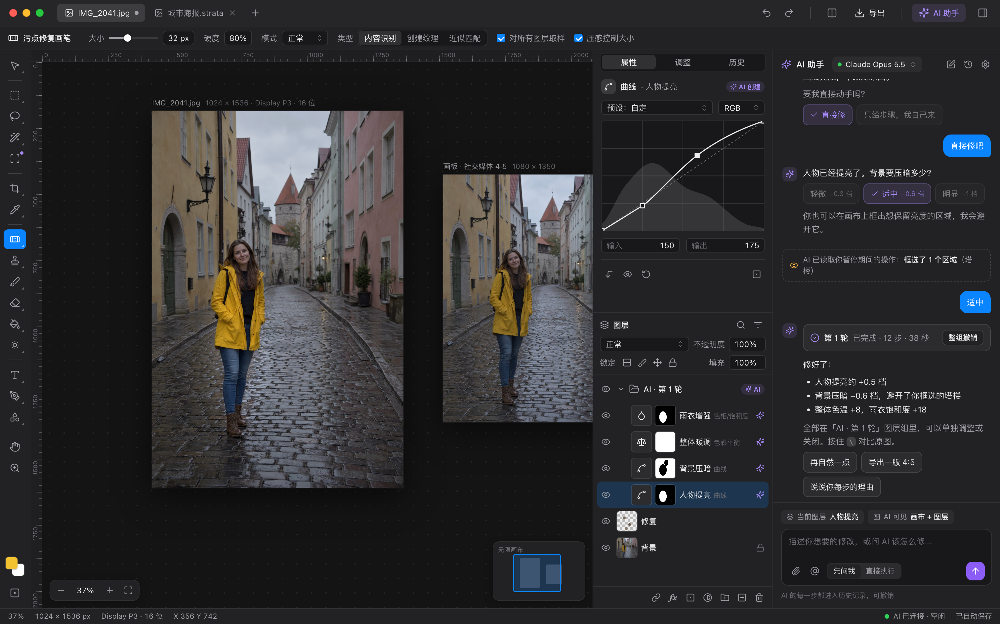

# Strata 第一版界面关键点

| 项目 | 内容 |
|---|---|
| 状态 | 已确认：第一版按此执行；颜色后期再调整 |
| 日期 | 2026-11-02 |
| 设计稿 | [strata-ui-mockup.html](strata-ui-mockup.html)：可点击，键盘 1–4 切换状态，T 切换深浅色；地址加 `?clean=1` 可隐藏顶部的原型控制条 |
| 截图 | [screenshots/](screenshots/) |
| 相关文档 | [总体设计](2026-11-02-strata-v1-design.md) · [第一版实施计划](../plans/2026-11-02-strata-v1-roadmap.md) |



> 设计稿是静态 HTML，只用来确定布局、信息层级和交互状态，不代表最终的 Swift 实现方式。画布上的照片由 AI 生成，仅作示例。

> 2026-11-02 计划修订：本稿展示完整 v1.0；v0.1 只呈现路线图 M1/M2 已实现能力，未交付工具隐藏或明确标注不可用。保存恢复、文件覆盖与图片外发授权提示必须在预览版就具备；本轮不修改原型截图或既定颜色方向。

---

## 1. 设计原则

1. **像一个原生 Mac 应用**：标题栏和工具栏一体，红黄绿窗口按钮，系统字体，紧凑的控件尺寸，遵循 macOS 的交互习惯。
2. **不干扰颜色判断**：默认深色，界面全部使用中性灰，没有彩色倾向（修图时界面颜色会影响对照片颜色的判断）。浅色主题同样提供。
3. **一眼分清人和 AI**：AI 相关的一切都用同一种颜色（当前为紫色）；需要用户决定时用琥珀色。
4. **看得见 AI 在做什么**：AI 每一步都有记录，画布上能看到 AI 正在处理的区域，图层面板里高亮 AI 正在改的图层。
5. **不打扰手动用户**：不接模型时，软件就是一个完整的修图工具；AI 面板可以收起。
6. **照顾 Photoshop 用户的习惯**：工具分组、快捷键、选项栏、面板名称尽量与 Photoshop 一致。

---

## 2. 窗口结构

```
┌──────────────────────────────────────────────────────────────────────────────┐
│ ● ● ●  [IMG_2041.jpg •] [城市海报.strata] [+]    ↶ ↷ │ ◫ │ ⤓导出 │ ✦AI 助手 │ ▣ │  标题栏 40
├──────────────────────────────────────────────────────────────────────────────┤
│ ▤ 污点修复画笔 │ 大小 ──●── 32px │ 硬度 80% │ 模式 正常 │ 类型 [内容识别|…] │ ☑ …   │  选项栏 36
├────┬───────────────────────────────────────┬──────────────┬─────────────────┤
│工具│ 标尺                                   │ [属性|调整|历史]│ ✦ AI 助手  模型 ▾│
│ 栏 │                                        │              │                 │
│    │        无限画布                         │  属性 / 调整 / │   对话与步骤     │
│ 46 │     ┌──────┐     ┌────┐                │  历史（47%）   │                 │
│    │     │ 文档  │     │画板│                ├──────────────┤                 │
│    │     │      │     └────┘                │  图层（53%）   │                 │
│    │     └──────┘                           │              ├─────────────────┤
│    │ [− 37% + ⛶]                  [小地图]   │  底部操作按钮  │  输入区          │
├────┴───────────────────────────────────────┴──────────────┴─────────────────┤
│ 37% │ 1024 × 1536 px │ Display P3 · 16 位 │ X 356 Y 742     ● AI 已连接 · 空闲 │  状态栏 24
└──────────────────────────────────────────────────────────────────────────────┘
          工具栏 46          画布（自适应）               检查器 272       AI 面板 344
```

- 设计基准分辨率：1512 × 982（14 英寸 MacBook Pro 默认），最小支持 1280 宽。
- 检查器与 AI 面板之间、画布与检查器之间的分隔线可拖动调整宽度；AI 面板可整体收起（⌘J）。【Claude 的判断】
- 第一版**不做**面板自由停靠和浮动面板，四栏布局固定。【Claude 的判断】

---

## 3. 各区域说明

### 3.1 标题栏（统一工具栏）

| 元素 | 说明 |
|---|---|
| 文档标签页 | 多文档以标签页切换；未保存的文档显示圆点；新建标签按钮 |
| 撤销 / 重做 | AI 暂停时仍可用（用于撤销 AI 的步骤） |
| 对比原图 | 按住 `\` 也可以对比；AI 执行中仍可用（属于查看类） |
| 导出 | 打开导出对话框 |
| AI 助手 | 显示 / 收起 AI 面板（⌘J），始终用 AI 颜色标识 |
| 右侧面板开关 | 收起检查器与 AI 面板，专注画布 |

### 3.2 工具选项栏

显示当前工具的参数，内容随工具切换。设计稿中以"污点修复画笔"为例：大小（滑块 + 数值）、硬度、模式、类型（内容识别 / 创建纹理 / 近似匹配）、对所有图层取样、压感控制大小。

### 3.3 工具栏

按 Photoshop 的分组排列，组之间用分隔线隔开；右下角带小三角的工具表示有同组工具（长按或右键展开）。

| 分组 | 工具（快捷键） |
|---|---|
| 移动 | 移动 V |
| 选择 | 选框 M · 套索 L · 快速选择 / 魔棒 W · 选择主体（带 AI 小圆点，表示由模型实现） |
| 裁剪与取样 | 裁剪 C · 吸管 I |
| 修饰与绘画 | 污点修复 / 修复画笔 J · 仿制图章 S · 画笔 B · 橡皮擦 E · 渐变 / 油漆桶 G · 减淡 / 加深 / 海绵 O |
| 文字与矢量 | 文字 T · 钢笔 P · 形状 U（钢笔与形状在第一版中先显示入口，功能在第二批） |
| 导航 | 抓手 H · 缩放 Z（AI 执行中仍可用） |
| 底部 | 前景色 / 背景色 · 快速蒙版 Q |

> 第一版工具栏中，第二批才实现的工具（钢笔、形状）是否显示，由实现者决定：可以隐藏，也可以显示为"即将推出"。

### 3.4 画布（无限画布）

- 背景是中性深灰加淡淡的点阵，表示这是一张无边界的画布。
- **文档和画板浮在画布上**，左上方显示名称和规格（如 `IMG_2041.jpg 1024 × 1536 · Display P3 · 16 位`）。打开一张图片会自动创建一个同尺寸的画板；可以在旁边新建其他画板（如"社交媒体 4:5"）。
- 顶部和左侧有标尺。
- 左下角是缩放控件（缩小、百分比、放大、适合屏幕）；右下角是小地图，显示画布上所有内容和当前视野。
- 画布上的叠加层：选区蚂蚁线、变换框、参考线、AI 正在处理的区域（AI 颜色虚线框 + 标签，如"AI · 选择主体"）、用户在暂停期间框选的区域（琥珀色框 + 标签"你框选的区域"）。
- 顶部居中的**状态提示条**只在 AI 执行中和暂停时出现（见 §4）。

### 3.5 检查器（右侧第一栏）

**上半部分：属性 / 调整 / 历史 三个标签页**

- **属性**：显示当前图层的参数。调整图层显示对应的编辑器，例如曲线显示曲线图（叠加直方图）、预设、通道、输入 / 输出数值，底部是剪贴到下层、查看上一状态、复位、蒙版属性按钮。由 AI 创建的图层在标题旁显示"AI 创建"标签。像素图层显示变换（W / H / X / Y）和外观（混合模式、不透明度、填充）。
- **调整**：新建调整图层的按钮网格，覆盖第一版的全部调整类型。
- **历史**：每文档的人和 AI 共用一条可撤销文档历史。AI 回合折叠为组，暂停期间用户修改也标为“你”；仅当前历史尾部回合可直接整组撤销，有后续修改时明确提示。保存/导出等外部执行记录单独展示，并标注“不随文档撤销恢复”。

**下半部分：图层面板**

- 顶部：混合模式、不透明度；锁定（透明像素、像素、位置、全部）、填充。
- 图层行从左到右：眼睛（显隐）→ 缩进（组内图层）→ 图层缩略图（调整图层显示类型图标）→ 蒙版缩略图 → 名称 + 灰色的类型说明 → 右侧标记（AI 创建标记、锁）。
- AI 创建的图层组显示"AI"标签，组名默认为"AI · 第 N 轮"。
- 底部按钮：链接、图层样式（fx）、添加蒙版、新建调整图层、新建组、新建图层、删除。

### 3.6 AI 面板（右侧第二栏）

**顶部**：标题"AI 助手"、当前模型（带连接状态圆点，点击切换模型）、新对话、对话记录、模型设置。

**对话区的消息类型**：

| 类型 | 样式与用途 |
|---|---|
| 用户消息 | 右对齐的蓝色气泡 |
| AI 文字 | 左侧 AI 头像 + 正文，支持列表 |
| 选项按钮 | AI 提问时给出的可点选项；选过之后显示为"已选"，其他选项变淡 |
| 执行卡片 | 一轮操作的步骤列表。卡片头显示轮次、状态（执行中 / 已暂停 / 已完成）、步数、用时和"整组撤销"。每一步显示：状态图标（完成 / 进行中 / 等待）、步骤名、命令标签（如 `select.subject`）、耗时。浏览目录的步骤显示路径（如 `目录 › 选择 › 主体`），**让用户看到 AI 是一层层找到功能的**。正在执行的步骤展开显示参数。本轮完成后卡片折叠成一行 |
| 系统提示 | 虚线框，例如"AI 已读取你暂停期间的操作：框选了 1 个区域（塔楼）" |

**输入区**：

- 上方的上下文标签：当前图层、当前选区、AI 能看到的内容（画布 + 图层）。
- 输入框：附加参考图、@ 引用图层或选区、**执行方式开关（先问我 / 直接执行）**、发送按钮；AI 执行中发送按钮变成红色停止按钮。
- 底部提示：AI 的文档修改可撤销；已完成的保存/导出不会因撤销而恢复磁盘文件。
- 文件授权与图片外发确认由宿主呈现：明确提供方地址、发送画布/区域范围、目标文件与是否覆盖；“直接执行”不能跳过这些边界。停止时区分“未提交已取消”与“文件已写入”，不显示虚假的整体回滚成功。

**未接入模型时**：显示接入引导，包括说明文字、三种接入方式（Anthropic / OpenAI 兼容接口 / 本地模型）、API Key、模型选择、"连接并测试"按钮，以及三条提示：密钥只存在本机钥匙串；模型需要支持工具调用，能看图的效果更好；不接模型也能完整使用所有手动功能。

### 3.7 状态栏

左侧：缩放比例、文档尺寸、色彩空间与位深、光标坐标。右侧：AI 状态（带颜色圆点）、自动保存/恢复检查点状态与最近成功时间；失败不显示“已保存”，提供重试/另存为/恢复入口。

---

## 4. 四种界面状态

| | ① 手动编辑 | ② AI 执行中 | ③ AI 等你决定 | ④ 未接入模型 |
|---|---|---|---|---|
| 截图 | [ui-v1.png](screenshots/ui-v1.png) | [ui-v1-ai-running.png](screenshots/ui-v1-ai-running.png) | [ui-v1-ai-paused.png](screenshots/ui-v1-ai-paused.png) | [ui-v1-no-model.png](screenshots/ui-v1-no-model.png) |
| 可操作的部分 | 全部 | 只有 AI 面板，加上缩放、平移、对比原图、查看历史 | AI 面板，加上缩放、平移、选框（用来指出区域）、撤销、开关图层显隐 | 全部（手动功能） |
| 其余界面 | 正常 | 变暗（约 32% 不透明、降低饱和度）、不可点击 | 变暗、不可点击 | 正常 |
| 画布 | 正常 | AI 颜色描边加内发光；显示 AI 正在处理的区域 | 琥珀色描边；显示用户框选的区域 | 正常 |
| 顶部提示条 | 无 | 转圈图标 + "AI 正在修图 · 第 N 步：步骤名" + "界面只读，可缩放平移查看" + 红色"停止 ⌘." | 暂停图标 + "AI 在等你决定 · 现在可以缩放查看、框选区域、撤销" + "结束本轮" | 无 |
| 图层面板 | 正常 | AI 正在操作的图层保持高亮并带流光动画，其余变暗 | 变暗，但眼睛按钮可用（方便对比效果） | 正常 |
| 检查器默认标签 | 属性 | 历史 | 历史 | 属性 |
| 面板标题 | 正常 | 显示锁图标 | 显示锁图标 | 正常 |
| 状态栏 | 绿点"AI 已连接 · 空闲" | 闪烁的 AI 色圆点"AI 执行中 · 界面只读" | 琥珀色圆点"等待你的决定 · 可少量操作" | 灰点"未接入模型 · 手动模式" |

> 界面变暗只是表现。真正的限制在核心的操作权锁里（见总体设计 §6.6）。

浅色主题见 [ui-v1-light.png](screenshots/ui-v1-light.png)。

---

## 5. 颜色语义（当前取值，后期调整）

> 用户已指出颜色可能需要调整，后期统一修改。实现时所有颜色**必须走设计令牌**，不能在代码里写死色值，方便以后整体替换。

| 令牌 | 用途 | 深色 | 浅色 |
|---|---|---|---|
| `bg-window` | 窗口背景 | `#1c1c1e` | `#ececee` |
| `bg-panel` | 面板背景 | `#222224` | `#f4f4f5` |
| `bg-canvas` | 画布背景 | `#141415` | `#d6d6d8` |
| `text` / `text-2` / `text-3` | 主要 / 次要 / 辅助文字 | `#ececee` / `#a1a1a6` / `#6c6c71` | `#1d1d1f` / `#6e6e73` / `#a1a1a6` |
| `accent` | 选中、当前工具、用户消息 | `#0a84ff` | `#007aff` |
| `ai` | 一切与 AI 相关的元素 | `#a78bfa` | `#7c3aed` |
| `warn` | 需要用户决定（AI 暂停） | `#ffb340` | `#c77700` |
| `ok` | 已连接 | `#30d158` | `#248a3d` |
| `danger` | 停止、删除 | `#ff453a` | `#d70015` |

完整令牌见设计稿 `strata-ui-mockup.html` 开头的 CSS 变量。

---

## 6. 字体与尺寸

| 项目 | 取值 |
|---|---|
| 界面字体 | 系统字体（SF Pro；中文为苹方） |
| 等宽字体 | SF Mono（命令标签、参数） |
| 面板正文 | 12 px |
| 聊天正文 | 12.5 px |
| 图层行高 | 40 px（缩略图 30 px） |
| 控件高度 | 22 px（输入框、下拉框） |
| 圆角 | 控件 5–7 px，卡片 10 px |

---

## 7. 快捷键

| 快捷键 | 作用 |
|---|---|
| ⌘J | 显示 / 收起 AI 面板 |
| ⌘. | 停止 AI |
| `\`（按住） | 对比原图 |
| ⌘Z / ⇧⌘Z | 撤销 / 重做 |
| ⌘0 | 适合屏幕 |
| V M L W C I J S B E G O T P U H Z Q | 工具切换，与 Photoshop 一致 |

---

## 8. Swift 实现要点

- **窗口**：`NSWindow` + 统一样式的 `NSToolbar`（标题栏和工具栏合为一体）。
- **画布**：AppKit 的 `NSView` 子类，持有 `CAMetalLayer`，由 Rust 核心通过 wgpu 直接渲染。鼠标、触控板（双指缩放平移）、压感笔事件在这里采集，交给核心的交互会话处理。
- **面板**：SwiftUI，通过 UniFFI 订阅核心的事件（图层变化、历史变化、锁状态变化）来刷新。
- **面板背景用实色**，不使用毛玻璃效果，避免背景颜色透进来影响颜色判断。
- **颜色令牌**集中定义（例如放在 Asset Catalog 中，带深浅两套），所有视图只引用令牌。
- **锁状态**由核心推送；外壳收到后统一切换各区域的可用状态，不在各个视图里分别判断业务规则。

---

## 9. 待定事项

| 事项 | 当前处理 |
|---|---|
| 颜色方案 | 后期统一调整（用户提出） |
| 第二批工具（钢笔、形状）在第一版是否显示 | 留给实现者 |
| 面板自由停靠、浮动面板 | 第一版不做 |
| 全屏模式、多窗口 | 第一版按 macOS 默认行为处理 |
| 设计稿中的模型名称 | 仅作示例，实际显示用户配置的模型 |
